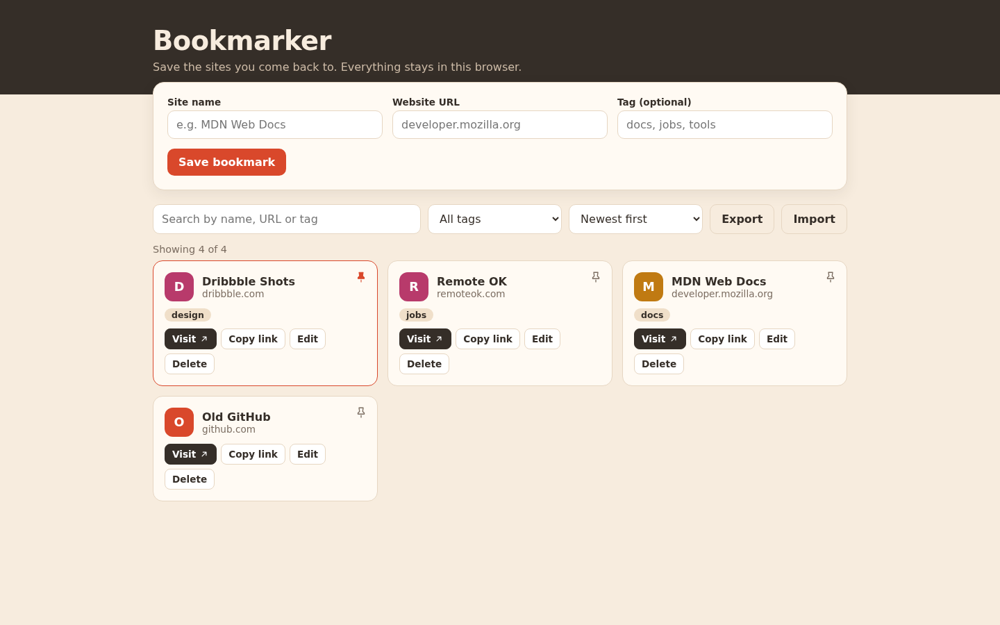
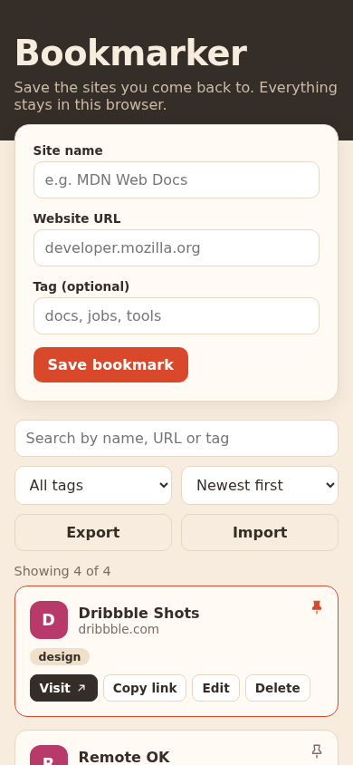

# Bookmarker

A bookmark manager that saves your favorite sites to localStorage. Add a site by
name and URL, visit it in a new tab, edit it in place, or delete it - everything
persists between sessions.

**Live demo:** https://malakmo7amed309.github.io/bookmarker/

## Screenshots

| Desktop | Mobile |
| --- | --- |
|  |  |

## Features

- Full CRUD: add, visit, edit and delete bookmarks, with Undo after delete
- Tags, tag filter, search, sort (newest, A to Z, pinned first) and pin favorites
- Duplicate URL detection, copy link, JSON export and import
- Card layout with colored letter avatars (no external icon fonts)
- Input validation (site name length + URL format) with an inline error message
- Automatic `https://` prefix when the URL has no protocol
- Saved to localStorage, so bookmarks survive a refresh
- HTML escaping on rendered bookmark names

## Tech stack

- HTML5, CSS3
- Vanilla JavaScript (localStorage, DOM rendering)
- Custom CSS and inline SVG icons (no frameworks)

## Run locally

Open `index.html` in a browser. No build step.

## Author

Malak Mohamed - [GitHub](https://github.com/malakmo7amed309)
